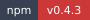

<!-- markdownlint-disable MD013 MD033 -->
<!-- This file is generated by Paradox. Do not edit manually. -->

# @ankhorage/board

        

Provides explicit Ankh provider bootstraps for boarding websites and source artifacts into Ankhorage.

Provide an explicit, capability-based boundary for importing website and OpenAPI sources and generating boarding manifests.

## Usage

### CLI

Ankhorage packages expose their command-line interface through `ankh`. Use `ankh --help` to discover available package commands, or run a package command with `--help` for package-specific usage.

```zsh
# Install the Ankhorage CLI
bun add --global @ankhorage/ankh

# Show usage information for board
ankh board --help
```

### Website-source boarding

Website-source boarding

`@ankhorage/board` inspects a single public website URL and emits a
deterministic `WebBoardingPlan` JSON document through its standalone CLI.

Current standalone commands are `board web <url>`, `board web <url> --plan`,
`board openapi <source>`, and `board manifest generate <source>`. Root
planning is available through `ankh plan board web <url>` and produces a
generic `AnkhCommandPlan` without calling Board execution handlers.

Project creation, crawling, and root CLI sugar remain deferred.

```ts
await runCli(['--help']);
```

## Documentation

Open `paradox/index.html` locally in your browser to browse the complete documentation.

## Contributors

<!-- readme: contributors -start -->
<!-- readme: contributors -end -->

## Donation

If this project is useful to you, you can support its continued development.

[Support @ankhorage](https://github.com/sponsors/ankhorage)
